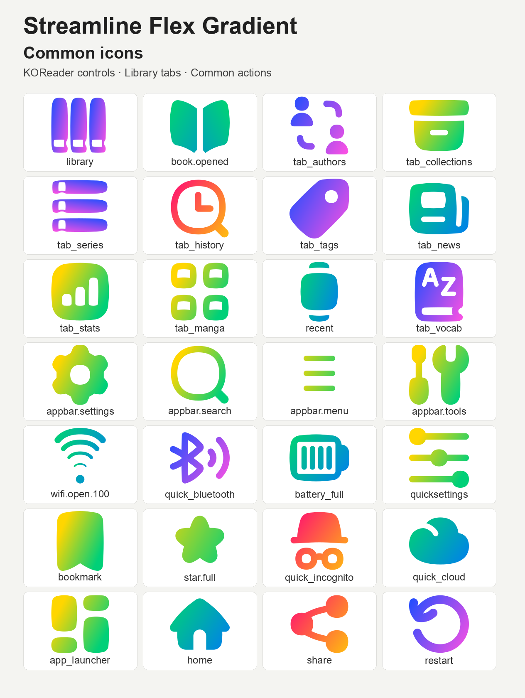

# Streamline Flex Gradient for ZenOS

Colourful SVG icons from [Streamline](https://streamlinehq.com), packaged by
[ZenLabs](https://github.com/xZenLabs) for [ZenOS](https://github.com/xZenLabs/zen-os)
and KOReader.

## Icon overviews



This repository contains one pack: **Streamline Flex Gradient for ZenOS**.
Its **244 editable SVGs** use exact runtime lookup filenames and build into
`dist/zen-streamline-flex-gradient.zip`. It themes all **23 built-in choices under
Navbar → Tabs → Add → Tab**.

## Icons and coverage

ZenPM's KOReader frontend is covered: all **39 bundled SVG names** and
**33 inline menu names** (**63 unique lookups**). Navigation, all 12 categories,
package and queue actions, verification badges, source icons, search, filtering,
sorting and settings use matching artwork. ZenPM must support the selected ZenOS
icon pack for these replacements to appear. Downloaded package logos and previews
retain their own artwork.

The pack uses the open-licensed `flex/gradient` assets from
[Streamline's free vector repository](https://github.com/webalys-hq/streamline-vectors).
The upstream revision is pinned to `52d750c9ce051e51cb181b7a78932120c48541d0`.
The 500-design free set supplies 107 original designs used here. There are
100 unchanged original SVGs and 41 adaptations; additional lookup files copy
that artwork unchanged.

- Library uses three upright books; Series uses a horizontal stack.
- Favorites uses a filled gradient star.
- Continue Reading uses an open book; Manga uses four image panels.
- News uses a newspaper, Tags a tag, and Folder a plain folder.
- Controls and Quick Settings use sliders. The launcher, vertical three-dot menu,
  plain close X, navigation arrows, text alignment, power, restart and sleep are included.
- Battery states show zero through four charge bars, plus a separate charging icon.
  Open and secured Wi-Fi show five distinct signal levels.
- Settings, search, Bluetooth, incognito, AI, cloud, screenshots, statistics,
  calendar, translations, vocabulary, tools and other suitable matches are included.

Some designs require small adaptations to supply the correct UI symbol. Books
reuse the original cover or page shapes. Navigation, menu lines, the X, dots,
plus and stars reuse shapes extracted from upstream icons. Battery and Wi-Fi
states retain upstream silhouettes or arcs and gradients.
Every source name, pinned upstream link, adaptation and SVG checksum is recorded
in [icon-sources.csv](icon-sources.csv).

Specialised reading-status, orientation and direction glyphs, Zen mode, crossword,
RSS and other lookups without a suitable match use the normal ZenOS or KOReader
fallback. Inline battery font glyphs continue to use their fonts.

## Source layout

Each style keeps category folders directly beside `pack.json`.
Categories without replacement artwork can be absent:

```text
<Style>/
├── pack.json
├── navbar/
├── controls/                 # Quick settings and Zen controls
├── launcher/
├── zenpm/                    # Includes verification shields
├── lookup/
├── menus/                    # Zen menu entry points
├── reader/                   # Page browser: TOC, vocabulary, view modes
├── device/
└── koreader/                 # Stock KOReader icons, including plus/info
```

[ICON-LIST.md](ICON-LIST.md) lists the filenames by category. Page-browser TOC, vocabulary-builder,
and view icons belong in `reader/`. All stock KOReader icons, including `appbar.*`,
the Aa font button, plus/info, bookmarks, and `book_open`, belong in `koreader/`. Quick settings
belong in `controls/`; `tab_left` and `tab_right` belong in `navbar/`.
Shared lookup names appear only once per style;
different lookup names can be edited independently.

Legacy SimpleUI `qa_group` and `qa_plugin` files are omitted. ZenPM uses
`plugin.svg`; its verification shields belong in `zenpm/`.
The builder flattens the categories into the pack root in release ZIPs,
so installed lookup names and artwork remain unchanged apart from the two
obsolete SimpleUI names. Missing icons keep their normal bundled fallbacks.

## Install

1. Build the pack below, or download `zen-streamline-flex-gradient.zip` from a release.
2. Copy the ZIP into `koreader/icons/zen/` on your device.
3. Open **Zen Settings → Interface**, enable **Custom icons**, and select
   **Streamline Flex Gradient for ZenOS** under **Custom icons → Custom icon pack**.
4. Restart KOReader.

ZenOS validates and extracts the ZIP. Alternatively, extract it and copy its
`zen-streamline-flex-gradient` folder into `koreader/icons/zen/`.
Keep `pack.json` and SVG files directly inside that folder.
See the [ZenOS icon pack guide](https://github.com/xZenLabs/zen-os/blob/main/docs/icon-packs.md).

## Build and release

For your own pack, start with the [Zen icon pack template](https://github.com/xZenLabs/icon-pack-template).

Each pack manifest includes `"color": true` for colour artwork or
`"color": false` for monochrome artwork. Per-style values are retained in the
release ZIPs when building the whole repository.

```sh
python3 -m venv .venv
source .venv/bin/activate
python3 -m pip install -r scripts/requirements.txt
python3 -m unittest discover -s scripts -p 'test_*.py'
python3 scripts/build-zen-packs.py
```

The output is `dist/zen-streamline-flex-gradient.zip`. Build the variant directly
with `python3 scripts/build-zen-packs.py "Streamline Flex Gradient"`.
Use `--output` for a different output directory and `--version` to override the
manifest version. Root and variant `pack.json` describe the same pack.

The existing Python builder is reused with the pack's aliases. It preserves
source SVGs, prefers explicit icons over aliases, validates the archive and
produces reproducible ZIPs. The optional legacy Lua parser remains available for
other input packs. Tests cover lookup names, source uniqueness, checksums,
internal SVG references, attribution, archives and version overrides.

The release workflow runs on pushes to `main` or through **Actions → Release
Zen icon packs → Run workflow**. When a push increases root `pack.json`'s
version above its value on `main` before the push, it releases that exact version.
Otherwise, including manual workflow runs, it selects the next patch version above
the higher of root `pack.json` and existing release tags. It runs tests, validates
the ZIP and publishes it.

## Credits and licence

Artwork by **Streamline / Webalys** — [streamlinehq.com](https://streamlinehq.com).
Icons and their adaptations are licensed under **Creative Commons Attribution
4.0 International (CC BY 4.0)**. Give appropriate credit, link to the licence
and indicate modifications when redistributing.

The attribution, upstream revision, modification notice and full licence text
are in [LICENSE-ICONS.txt](LICENSE-ICONS.txt), which is included in the ZIP.
The original upstream notice and CC BY 4.0 text are retained in [licenses](licenses/).
Only the free repository assets are included.

Repository code retains its **AGPL-3.0** [LICENSE](LICENSE).
Support ZenLabs through [Ko-fi](https://ko-fi.com/xzenlabs).
